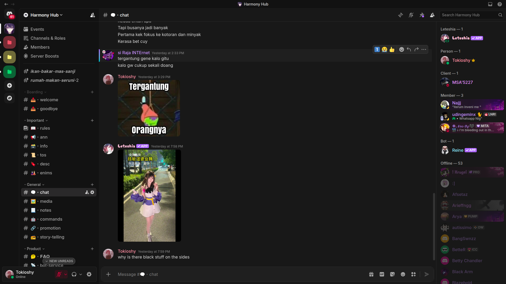

# Obsidian Aurora 🌌

Modern dark theme for Vencord featuring oklch color spaces, gradient accents, glassmorphic panels, smooth animations, and custom typography (Inter & JetBrains Mono).



## ✨ Features

- **Modern Color Palette**: Built using OKLCH color space for vivid, balanced dark mode aesthetics.
- **Glassmorphism**: Subtle blur effects and backdrop filters on popouts and context menus.
- **Smooth Animations**: Micro-interactions on channel hover, server icons, and message highlighting.
- **Custom Fonts**: Pre-configured with Inter for UI and JetBrains Mono for code blocks.

## 🚀 Installation

### Quick Install (Vencord Web / Desktop)

1. Copy the raw link below:
    ```
    https://raw.githubusercontent.com/Tokioshi/discord-theme/main/obsidian-aurora.theme.css
    ```
2. Open Discord -> Settings -> Vencord Settings -> Themes.
3. Paste the URL into the Edit QuickCSS section and hit Enter.

### Manual / Local Install

1. Download obsidian-aurora.theme.css.
2. Open Vencord Settings -> Themes -> Open Themes Folder.
3. Move the downloaded `.css` file into that folder.

## 📄 License

Distributed under the MIT License. See `LICENSE` for more information.
